<p align="center">
  
</p>

<h1 align="center">XPU-Atlas</h1>

<p align="center"><strong>The processor market, mapped with evidence.</strong><br>
A plain-English, fully sourced atlas of 20 processing-unit paradigms — built from 64 graded claims, 58 sources, three frozen public datasets, seven figures, a design-space simulator, and a one-command audit.</p>

<p align="center">
  <a href="https://m0-ar.github.io/xpu-atlas/"><strong>Open the live atlas</strong></a> ·
  <a href="https://m0-ar.github.io/xpu-atlas/preview.html">preview.html</a> ·
  <a href="https://m0-ar.github.io/xpu-atlas/docs/preview.html">docs/preview.html</a> ·
  <a href="docs/PAPER.md">Read the working paper</a> ·
  <a href="#-beginner-guide--read-this-and-you-are-a-professional">Beginner guide</a> ·
  <a href="#-quick-start">Quick start</a>
</p>

<p align="center">
  <a href="https://github.com/M0-AR/xpu-atlas/releases/tag/v0.1.0"></a>
  <a href="https://m0-ar.github.io/xpu-atlas/"></a>
  
  
  
  
</p>

## Abstract

**For the person with two minutes.** XPU-Atlas is a reproducible evidence audit of the processor market: 20 processing-unit paradigms, 64 graded claims, 58 sources, and a live page you can click. It shows what is real, what is inflated, and where value is moving — without asking you to trust a dashboard. The headline is credibility, not hype: 73.4% of claims are supported, but only 20.3% rest on primary evidence, and 40% of the paradigms were absorbed or integrated.

<p align="center">
  <a href="https://m0-ar.github.io/xpu-atlas/">
    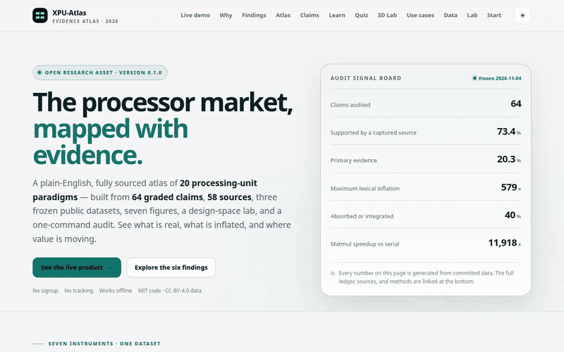
  </a>
</p>

> **What this is.** A decision-ready evidence base for anyone who has to explain, compare, invest in, teach, buy, or sell AI hardware. It turns a fast-moving narrative about CPUs, GPUs, TPUs, NPUs, DPUs, LPUs, QPUs, photonic chips, and biological computers into 64 claims you can inspect, each with a status, an evidence grade, and a source pointer.
>
> **What it is not.** Investment advice. A causal model. A live product database. A claim that one architecture “wins”. It is descriptive, reproducible, and deliberately honest about what is unverified.

---

## Executive summary

Five sentences for the person with two minutes:

1. **The market conversation is noisy; this repo makes it auditable.** It converts a popular 20-paradigm processor narrative into 64 stable claims, each graded against 58 public sources.
2. **The headline is credibility, not hype.** 73.4% of claims are supported (95% Wilson CI 61.5-82.7%), but only 20.3% rest on primary evidence — so the atlas shows both the support rate and the evidence quality.
3. **The strongest patterns are structural.** 40% of the paradigms were absorbed into other units or integrated into systems-on-chip; acronym searches inflate publication counts by a median of 4.8x; public attention is polarising; and market value has concentrated in integrators and the foundry.
4. **Every number is reproducible.** Three public snapshots are frozen with SHA256 hashes, seven figures and a full evidence register are generated, and `make all` reruns the offline pipeline — including a 39-experiment design-space screen.
5. **It is ready for a business conversation.** Use the interactive atlas for a board briefing, the claim explorer for diligence, the quiz for onboarding, and the paper for a deeper technical review.

<p align="center">
  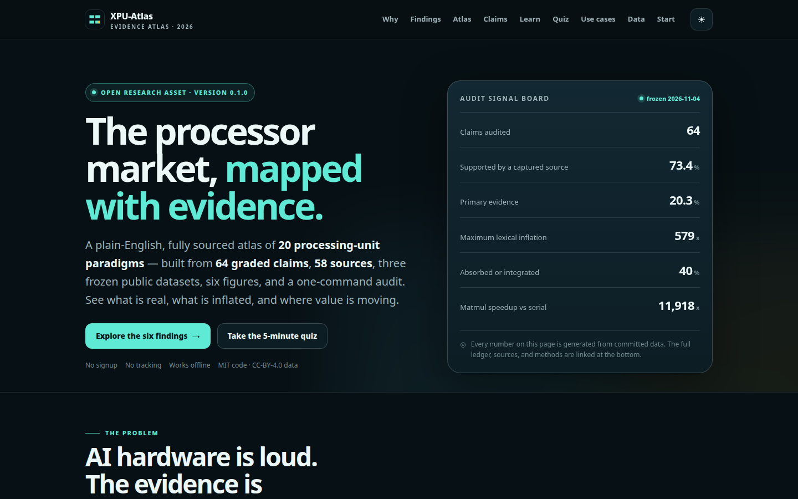
</p>

---

## Table of contents

- [Abstract](#abstract)
- [Executive summary](#executive-summary)
- [Why this exists](#why-this-exists)
- [What you get](#what-you-get)
- [Who it is for](#who-it-is-for)
- [User stories](#user-stories)
- [The six findings](#the-six-findings)
- [The design-space lab](#the-design-space-lab)
- [🌱 Beginner guide — read this and you are a professional](#-beginner-guide--read-this-and-you-are-a-professional)
- [Explore the atlas](#explore-the-atlas)
- [See it move](#see-it-move)
- [Live demo](#live-demo)
- [The 3D learning lab](#the-3d-learning-lab)
- [Features, explained](#features-explained)
- [The data](#the-data)
- [How the audit works](#how-the-audit-works)
- [Quick start](#-quick-start)
- [Releases and packages](#releases-and-packages)
- [Live site and GitHub Pages](#live-site-and-github-pages)
- [Project structure](#project-structure)
- [Quality and verification](#quality-and-verification)
- [Limitations](#limitations)
- [FAQ](#faq)
- [Glossary](#glossary)
- [Citation](#citation)
- [License](#license)
- [Contributing](#contributing)

---

## Why this exists

Every quarter brings a new processor label and a new confident explanation. The labels are memorable, but the claims behind them are rarely checkable. Is a DPU a real category or a marketing wrapper? Did a language processor get acquired, absorbed, or abandoned? Is public attention to a chip family rising because of adoption, or because of one viral month?

Those questions matter to more than engineers. They shape market maps, investment memos, procurement decisions, curricula, and product strategy. XPU-Atlas answers them the boring way: by writing down each claim, finding the best available source, grading the evidence, and keeping the negative results visible.

The repo is built around one rule: **a claim without a source is a hypothesis, not a fact.** That rule is enforced in the ledger, the generated tables, the figures, and the paper.

---

## What you get

| Asset | What it gives you | Where |
|---|---|---|
| **Interactive atlas** | A responsive, accessible web page with charts, a 20-paradigm map, a 64-claim explorer, a learning path, a 10-question quiz, a live tabbed demo, and a 3D learning lab. | [Live atlas](https://m0-ar.github.io/xpu-atlas/) · [`preview.html`](https://m0-ar.github.io/xpu-atlas/preview.html) · [`docs/preview.html`](https://m0-ar.github.io/xpu-atlas/docs/preview.html) |
| **Live tabbed demo** | A real product tour that loads the actual page in lazy iframes: Home, Findings, Atlas, Claims, Learn, Quiz, and 3D Lab. | [Live demo](#live-demo) · [`preview.html#demo`](https://m0-ar.github.io/xpu-atlas/preview.html#demo) |
| **3D learning lab** | A 20-concept game that grows a 3D network as you answer, narrates each idea, and keeps progress in your browser. | [The 3D learning lab](#the-3d-learning-lab) · [`preview.html#lab`](https://m0-ar.github.io/xpu-atlas/preview.html#lab) |
| **Graded claim ledger** | 64 claims across 20 paradigms, each with a status, grade, sources, and note. | [`data/claims.yaml`](data/claims.yaml) |
| **Evidence register** | Every source with publisher, type, grade, URL, and retrieval date. | [`docs/EVIDENCE.md`](docs/EVIDENCE.md) |
| **Generated results** | Every table behind every headline number. | [`docs/RESULTS.md`](docs/RESULTS.md) |
| **Design-space lab** | 39 analytical experiments across 13 candidate architectures, with latency–energy Pareto frontiers and explicit assumptions. | [`docs/SIMULATION.md`](docs/SIMULATION.md) |
| **Seven publication figures** | Lexical inflation, publication trajectories, attention, market economics, evidence gradient, latency–throughput, and the design-space frontier. | [`figures/`](figures/) |
| **Working paper** | A full methods, results, discussion, limitations, and reproducibility write-up. | [`docs/PAPER.md`](docs/PAPER.md) |
| **Frozen snapshots** | OpenAlex, Wikimedia, and Yahoo Finance data with SHA256 hashes. | [`data/snapshots/`](data/snapshots/) |
| **Reproducible pipeline** | Offline `make all`, Docker, tests, CI, and a paper consistency guard. | [`Makefile`](Makefile) |
| **Release and container** | v0.1.0 wheel, sdist, `SHA256SUMS`, and a GHCR image with SBOM and provenance. | [Releases and packages](#releases-and-packages) |
| **Business brief** | Executive summary, use cases, buyer questions, and a plain-English glossary. | This README |

---

## Who it is for

| You are… | You need… | Start with… |
|---|---|---|
| **A founder or product leader** | To know whether a new processor category is a durable market or a feature that will be absorbed. | [The six findings](#the-six-findings), then the [atlas](#explore-the-atlas). |
| **An investor or analyst** | To separate research activity, public attention, and market value — and to see where they diverge. | [Finding 04](#04--attention-is-polarising) and [Finding 05](#05--value-accrues-to-integrators-and-the-foundry). |
| **An enterprise buyer** | To ask vendors for the filing, the benchmark, or the standard behind the slide. | [The beginner guide](#-beginner-guide--read-this-and-you-are-a-professional) and the [claim explorer](https://m0-ar.github.io/xpu-atlas/preview.html#explorer). |
| **A journalist or creator** | To start from receipts instead of recycled numbers. | [The claim ledger](data/claims.yaml) and [EVIDENCE.md](docs/EVIDENCE.md). |
| **An educator or student** | A ready-made module on source grading, bibliometrics, and reproducible research. | [The learning path](https://m0-ar.github.io/xpu-atlas/preview.html#learn) and [the quiz](https://m0-ar.github.io/xpu-atlas/preview.html#quiz). |
| **An engineer or researcher** | A clean dataset, a reproducible pipeline, and honest limitations. | [Quick start](#-quick-start) and [METHODOLOGY.md](docs/METHODOLOGY.md). |

### User stories

| I want to… | So that… | Start here |
|---|---|---|
| Try the product without installing anything | I can judge it in one click | [Live demo](#live-demo) |
| Know whether a processor category is durable or a feature | I can position a product or ask better diligence questions | [The six findings](#the-six-findings) |
| See the evidence behind a headline number | I can separate support from primary support | [Claim explorer](https://m0-ar.github.io/xpu-atlas/preview.html#explorer) and [EVIDENCE.md](docs/EVIDENCE.md) |
| Learn the 20 paradigms and remember them | I can hold the map in my head, not just read it | [The 3D learning lab](#the-3d-learning-lab) and [learning path](https://m0-ar.github.io/xpu-atlas/preview.html#learn) |
| Teach source grading with a real artifact | I can run a workshop or a class from one repo | [Beginner guide](#-beginner-guide--read-this-and-you-are-a-professional) and [the quiz](https://m0-ar.github.io/xpu-atlas/preview.html#quiz) |
| Reproduce or ship the result | I can install a wheel, pull a container, and verify the checksums | [Quick start](#-quick-start) and [Releases and packages](#releases-and-packages) |

---

## The six findings

Every number below is generated from the committed snapshots and ledger. The full tables are in [docs/RESULTS.md](docs/RESULTS.md).

### 01 · Acronyms inflate search results

Unquoted publication searches overcount processor terms by a **median of 4.8x**. Five terms exceed **10x**. The extreme is **579x (PPU)**, but its denominator is only 11 exact-phrase papers, so read it as an illustration. The robust examples are **DPU at 187.8x** (219,566 vs 1,169), **ISP at 129.5x** (152,202 vs 1,175), and **NPU at 51.6x** (27,795 vs 539). Even CPU inflates by 4.9x.

**Business lesson:** if a market-size chart is built from a keyword count, ask whether the phrase was quoted and whether the denominator is reported.

### 02 · Primary evidence is improving — slowly

The primary-evidence share rises from **6.1%** before 2015 to **40.0%** for 2021–2026. The overall share is still **20.3%**. The era test gives Yates χ² = **6.83**, p = **0.009**, Cramér's V = **0.327**. This is a descriptive signal about source availability and verification practice, not a claim about the truthfulness of earlier engineers.

**Business lesson:** recent claims are easier to verify; older claims often need archival work. Budget for it before repeating a historical “first”.

The atlas also keeps conflicts visible. The US Air Force PS3 cluster is reported as **1,760** consoles in one source and **1,716** in another, so the claim stays conflicting rather than being silently rounded. The transcript’s “about $20” for Groq is retained as refuted because the reported deal is about $20 billion.

### 03 · Absorption beats replacement

**8 of 20** paradigms (**40%**) were absorbed into another unit or integrated into a system-on-chip. Absorbed: PPU, SPU, LPU. Integrated: APU, NPU, ISP, TPM/Secure Enclave, DPU. The standalone label often outlives the standalone chip.

**Business lesson:** the opportunity may be the system, the software layer, or the workflow — not another standalone chip.

### 04 · Attention is polarising

From 2021 to 2025, mean monthly Wikipedia pageviews rose **2,196%** for NPU and **2,506%** for neuromorphic computing from tiny bases, and **76.1%** for DPU. They fell **18.8%** for GPU, **38.4%** for ASIC, **41.9%** for MCU, and **47.7%** for CPU. Median change: **+10.6%**; 7 articles grew and 5 declined.

**Business lesson:** public curiosity and technical adoption are different signals. Do not use one as a proxy for the other.

### 05 · Value accrues to integrators and the foundry

Equal-weight monthly-price CAGRs: **integrators 33.4%**, **foundry 30.0%**, **legacy CPU 4.9%**, **mobile SoC -0.03%**. NVIDIA returned **48.8%** and TSMC **30.0%**; Intel returned **4.9%** and Qualcomm **-0.03%**. Arm returned **58.1%** over a shorter 38-month window. Cerebras is a six-month total return of **-55.7%** from its June 2026 close and **-47.1%** from its **$185** IPO price.

**Business lesson:** the window is descriptive, not causal. It includes an AI capex cycle, a memory shortage, export controls, and a concentrated bull market. A longer window and a factor model would be needed to separate architecture from those confounders.

### 06 · The latency–throughput gap is enormous

On one Intel Core i7-14700F (28 logical cores, Python 3.12.13, NumPy 2.2.6): serial Python sustains **18.0M** operations/s; NumPy vectorisation reaches **1.18B** operations/s, or **65.6x** that throughput; BLAS matmul reaches **11,918x** and **214.8** GFLOPS. Eight threads add only **2.29x**, with **28.7%** parallel efficiency. Two threads give **0.97x**. Matmul throughput is **4.1**, **30.5**, **111.7**, and **214.8** GFLOPS at n = 256, 512, 1024, and 2048.

**Business lesson:** “more cores” is not a universal answer. The workload must have enough arithmetic intensity and independent work to amortise memory traffic and synchronisation.

<p align="center">
  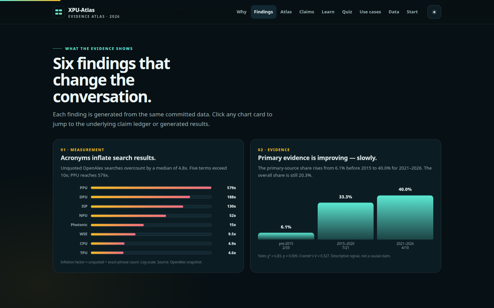
</p>

### The seven publication figures

Every chart is regenerated by `make all`; none is hand-drawn.

| Figure | What it shows |
|---|---|
| [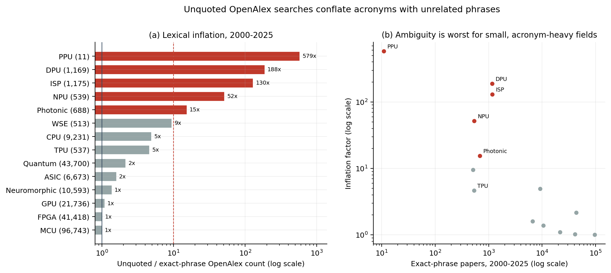](figures/fig1_lexical_inflation.png) | Unquoted vs exact-phrase OpenAlex counts, with the median and 10x threshold. |
| [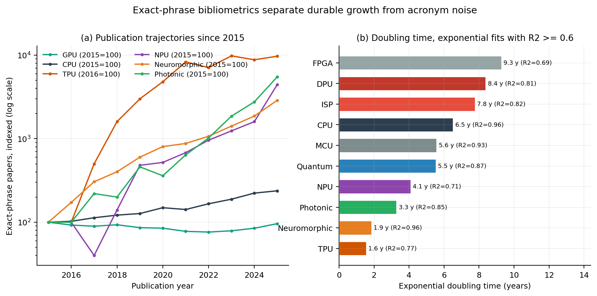](figures/fig2_publication_trajectories.png) | Publication paths for all 20 paradigms, split by era. |
| [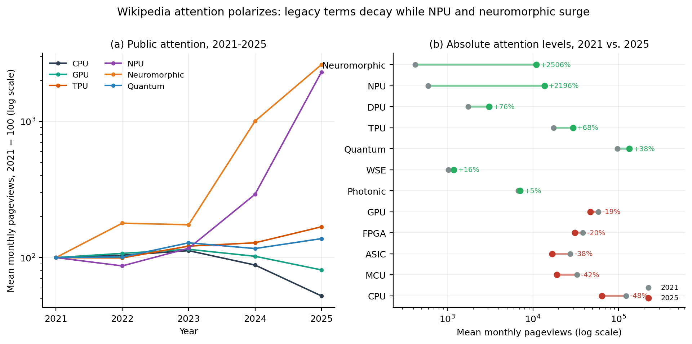](figures/fig3_attention_reallocation.png) | Wikipedia attention change from 2021 to 2025. |
| [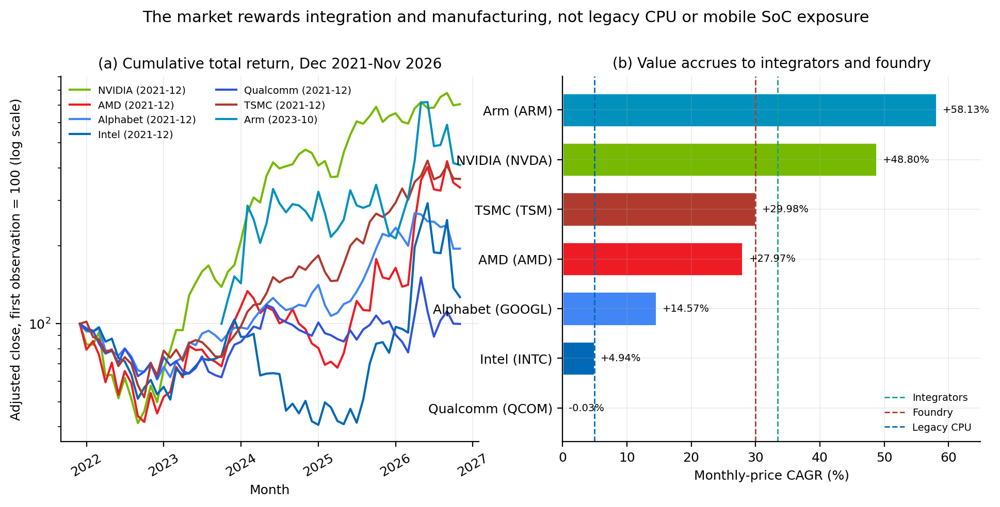](figures/fig4_market_economics.png) | Equal-weight market CAGRs and the Cerebras series. |
| [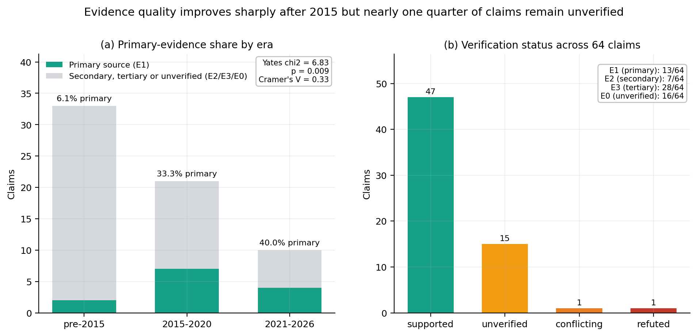](figures/fig5_evidence_gradient.png) | Primary-source share by era with confidence intervals. |
| [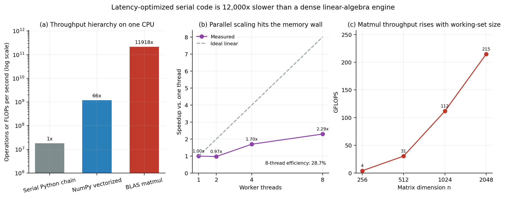](figures/fig6_latency_throughput.png) | Serial, vectorised, threaded, and matmul throughput on the reference CPU. |
| [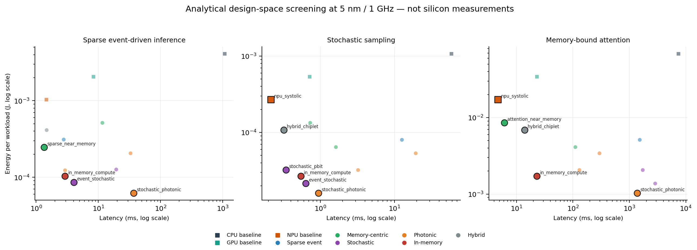](figures/fig7_design_space.png) | Latency–energy Pareto frontiers for 13 hypothetical architectures across three workloads. |

---

## The design-space lab

The evidence half of the atlas is descriptive. The design-space lab is the forward-looking half: a transparent screen of **13 candidate architectures** across **three workloads**, evaluated at a shared 5 nm / 1 GHz reference point. It covers **39 experiments** sampled from a **14,000-point structural design space** and reports latency, throughput, energy, area, and cost.


The screen does not crown a universal winner. Sparse event inference favors near-memory and event-driven designs; attention favors the NPU baseline, near-memory attention, and a hybrid chiplet; stochastic sampling rewards sampling-specific and in-memory designs. The photonic-stochastic candidate is energy-efficient but latency-heavy. These are hypotheses to test, not silicon results. The next gate is iso-accuracy validation, then RTL or FPGA prototyping.

Read the generated report and assumptions: [`docs/SIMULATION.md`](docs/SIMULATION.md).

---

## 🌱 Beginner guide — read this and you are a professional

You do not need a degree in computer architecture to use this repo. You need three habits: ask what the thing does, ask who says so, and ask how they know.

Let's work this out in a step-by-step way to be sure we have the right answer.

### Step 1 — Start with the job, not the acronym

A processor is a machine that turns inputs into outputs. Different processors are built for different jobs:

| Label | Plain-English job | Everyday analogy |
|---|---|---|
| **CPU** | Runs general-purpose software, one instruction after another, with a few fast cores. | A skilled project manager who can handle many different tasks. |
| **GPU** | Runs thousands of simple operations in parallel. | A stadium of workers doing the same motion at once. |
| **TPU** | Accelerates the matrix maths used by neural networks. | A calculator built for one kind of equation. |
| **NPU** | Runs neural-network inference close to the sensor or device. | A specialist embedded in a larger team. |
| **DPU** | Moves and processes data inside the network or data centre. | A customs officer for data traffic. |
| **LPU** | Optimises language-model inference. | A language specialist in a large firm. |
| **FPGA** | Lets the buyer rewire the hardware after manufacture. | A workbench you can rebuild for each job. |
| **ASIC** | Fixes one function into silicon for maximum efficiency. | A custom-built tool that does one job extremely well. |
| **QPU** | Uses quantum states to explore certain problems. | A probability machine with a very different rulebook. |
| **Photonic** | Moves and processes information with light. | A fibre-optic shortcut instead of copper wire. |
| **Neuromorphic** | Mimics spiking neurons and event-driven computation. | A brain-inspired circuit that works only when events arrive. |
| **Wetware** | Uses living neurons as a computing substrate. | A biology experiment that also computes. |

The point is not that one row beats another. The point is that each row answers a different question. A CPU is not a slow GPU; a GPU is not a general-purpose CPU; an NPU is often a block inside a larger chip.

### Step 2 — Learn the four evidence grades

Every claim in the ledger has one grade:

| Grade | What it means | Example |
|---|---|---|
| **E1** | **Primary.** Official release, regulatory filing, peer-reviewed paper, standard, or API dataset. | A company’s IPO pricing release; a peer-reviewed photonic-processor paper. |
| **E2** | **Secondary.** Reputable news wire, trade press, or expert analysis. | A major business-news report on an acquisition. |
| **E3** | **Tertiary.** Encyclopedia or general reference. | A Wikipedia article used for a definition or date. |
| **E0** | **Unverified, conflicting, or refuted.** Retained for transparency. | A product claim that no captured source confirms; two sources that disagree; a contradiction. |

Status and grade are different. A claim can be **supported** by an encyclopedia (E3), or **unverified** despite a plausible secondary mention (E0). The headline support rate counts support. The primary-evidence share counts only E1. That is why the atlas reports both **73.4%** supported and **20.3%** primary.

### Step 3 — Ask three questions of any hardware claim

1. **What is the unit of analysis?** Is this a chip, a block inside a chip, a system, a company, or a market category?
2. **Who is the source?** A vendor release is primary for what the vendor says, but not independent evidence that the product is faster.
3. **How would this claim fail?** If a claim cannot fail, it is marketing, not a testable statement.

### Step 4 — Read the charts like a professional

- **Inflation chart:** longer bar = more ambiguous acronym. The number is unquoted divided by exact-phrase count. Log scale, so a small visual difference can be a large numeric difference.
- **Evidence gradient:** taller bar = more primary evidence in that era. The sample is small, so read the direction, not a precise causal story.
- **Lifecycle bar:** each colour is a lifecycle label. “Absorbed” and “integrated” are the two consolidation categories.
- **Attention chart:** green bars grew, red bars shrank. Emerging terms start small, so a large percentage can still be a modest absolute number.
- **Market chart:** CAGR is a smoothed annual rate. It hides drawdowns, volatility, and the short Cerebras window.
- **Benchmark chart:** the gap between serial and matmul is a latency-versus-throughput illustration on one CPU, not an accelerator benchmark.

### Step 5 — The 10-minute path

1. Read the [Executive summary](#executive-summary) (2 minutes).
2. Skim the [six findings](#the-six-findings) (3 minutes).
3. Open the [live atlas](https://m0-ar.github.io/xpu-atlas/), click two paradigms, and filter two claims (3 minutes).
4. Take the [10-question quiz](https://m0-ar.github.io/xpu-atlas/preview.html#quiz) (2 minutes).

You will know more than most interview candidates.

### Step 6 — The 30-minute path

1. Read [the paper](docs/PAPER.md) sections 2–5.
2. Open the [claim ledger](data/claims.yaml) and find one `E0` claim. Ask what evidence would upgrade it.
3. Read [LIMITATIONS.md](docs/LIMITATIONS.md).
4. Run [`make all`](#-quick-start) and compare `results/summary.json` with the README.

That is the difference between repeating a narrative and understanding it.

---

## Explore the atlas

The interactive page is a single static HTML file with no external dependencies. It works offline, on a phone, and from GitHub Pages.

| View | What to do |
|---|---|
| **Home** | See the headline signal board and the six findings. |
| **Live demo** | Switch between real embedded product screens; each tab loads the actual page, not a picture. |
| **Atlas** | Filter 20 paradigms by lifecycle; click any card for year, claim count, support rate, and evidence mix. |
| **Claims** | Search all 64 claims; filter by status or grade; see the source IDs. |
| **Learning path** | Work through four levels from newcomer to practitioner; progress is saved in your browser. |
| **Quiz** | Answer 10 questions with instant explanations and a final score. |
| **3D Lab** | Build a 20-concept network; a correct answer adds a node, and the concept log records the idea. |
| **Data** | Inspect the three frozen datasets and their full SHA256 hashes. |

<p align="center">
  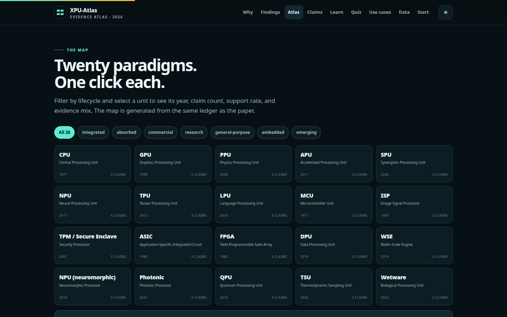
  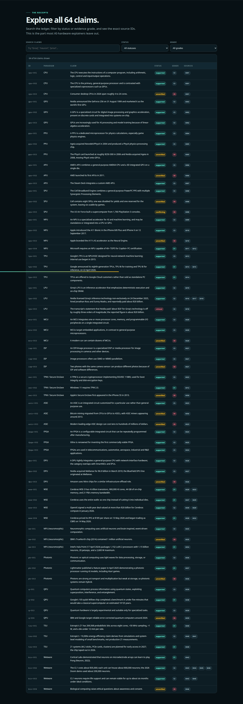
</p>

<p align="center">
  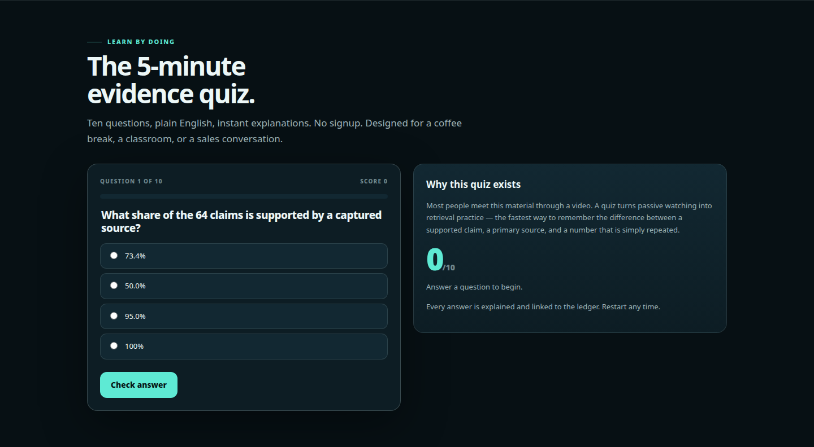
</p>

### See it move

- **Animated tour (10 s):** [`assets/xpu-atlas-demo.gif`](assets/xpu-atlas-demo.gif) — recorded from the live page; it shows the tabbed demo, the 3D lab, and a correct answer lighting a node.
- **Full-resolution video (21 s):** [`assets/xpu-atlas-demo.mp4`](assets/xpu-atlas-demo.mp4)
- **Social preview:** [`assets/social-preview.png`](assets/social-preview.png)

---

## Live demo

The live demo is the product, not a video of the product. It is a tab bar over an iframe: **Home**, **Findings**, **Atlas**, **Claims**, **Learn**, **Quiz**, and **3D Lab**. Selecting a tab loads `preview.html?embed=1#<section>` into the frame. The frame contains the same HTML, the same `assets/atlas-data.js` bundle, the same charts, filters, quiz, and 3D lab that ship in this repository. There is no second implementation to drift.

- **Lazy by design.** Only the active tab loads. The first paint stays light, and each screen is fetched when you ask for it.
- **Embed mode.** `?embed=1` hides the site header, the demo itself, and the footer, then scrolls to the requested section. That is how a tab shows a clean product screen without a second page.
- **Keyboard first.** The tab bar follows the ARIA tabs pattern. Left and Right move between tabs, Home and End jump to the ends, and the active tab is announced.
- **Deep links.** Every tab is a URL: `#demo` for the demo, `#lab` for the game, `#findings` for the evidence. The “Open full screen” link leaves the frame.
- **Works offline.** The page is static; no API key, database, or build server is required.

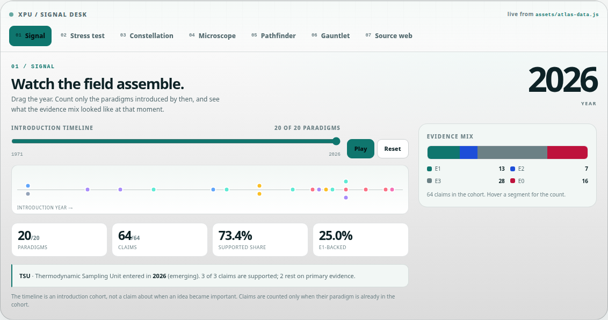

**Try it:** [Live demo](https://m0-ar.github.io/xpu-atlas/preview.html#demo) · **Open a tab directly:** [Findings](https://m0-ar.github.io/xpu-atlas/preview.html?embed=1#findings).

---

## The 3D learning lab

**Atlas Mind** is the part of the page that makes the map stick. It is a short game, not a decoration. A clue describes a workload in plain English; you pick the processing unit that fits. A correct answer adds that unit to a live 3D network, draws a synapse from the previous concept, speaks the idea aloud, and writes a line to the concept log. A wrong answer does not add a node; the concept returns later. The network starts as a single evidence core and grows into the same 20-paradigm map the atlas describes.

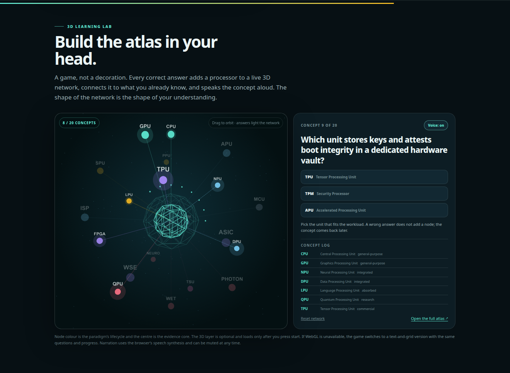

<p align="center">
  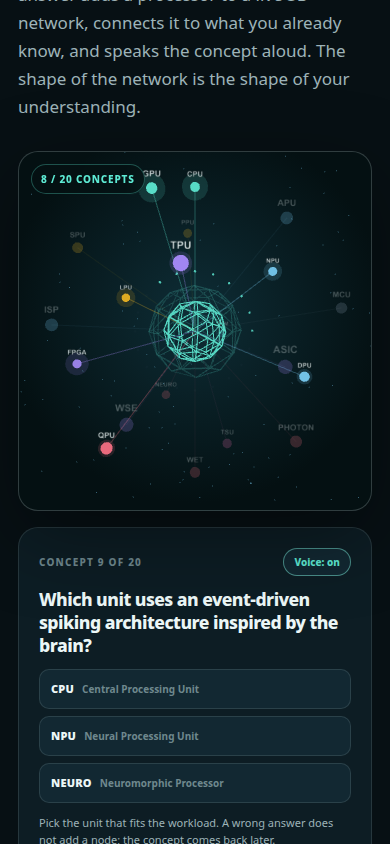
</p>

### Why the game is correlated with the message

| Game mechanic | What it mirrors in the atlas |
|---|---|
| The clue starts with the job, not the acronym. | The beginner guide starts with the job, not the label. |
| A correct answer lights one node. | Each paradigm is one claim-backed entry, not a category slogan. |
| A wrong answer keeps the concept in rotation. | Unverified and conflicting claims stay visible instead of being deleted. |
| Edges connect concepts you have already answered. | The atlas is a map of relationships, not a ranked list. |
| The progress ring fills to 20. | The learning path and the quiz track progress across the same 20 paradigms. |
| The concept log records the idea in plain English. | The claim ledger records the source, status, grade, and note. |
| The final call to action opens the quiz and findings. | The game is a doorway to the evidence, not a replacement for it. |

The game is a memory aid. It does not change the ledger, the support rate, or the evidence grades. The narration uses the browser’s Web Speech API when available; if it is not, the text and the log carry the same content. The 3D layer uses a locally vendored Three.js module and a canvas, with a text fallback for reduced-motion or WebGL-limited browsers. Progress is saved in `localStorage`; reset clears it.

**Try it:** [3D Lab](https://m0-ar.github.io/xpu-atlas/preview.html#lab) · **See the demo tab:** [Live demo](https://m0-ar.github.io/xpu-atlas/preview.html#demo) → **3D Lab**.

---

## Features, explained

| Feature | What it does | Why it matters |
|---|---|---|
| **Claim ledger** | Stores 64 claims with stable IDs, status, grade, sources, and notes. | Every statement is addressable and reviewable. |
| **Evidence grading** | Separates primary, secondary, tertiary, and unverified evidence. | Support is not the same as primary support. |
| **Generated evidence register** | Rebuilds the full source list from the ledger. | No hand-maintained bibliography drift. |
| **20-paradigm atlas** | Maps each unit by year, lifecycle, claims, support, and grade mix. | Shows consolidation, not just a flat list. |
| **Claim explorer** | Search and filter the entire ledger in the browser. | Diligence without reading YAML. |
| **Seven charts** | Publication inflation, trajectories, attention, markets, evidence, benchmarks, and the design-space frontier. | Makes the patterns visible. |
| **Design-space lab** | Screens 13 hypothetical architectures across 3 workloads under explicit assumptions. | Separates evidence from speculation and exposes trade-offs. |
| **Frozen snapshots** | Three public datasets with SHA256 hashes. | Reproducible version of record. |
| **Offline pipeline** | `make all` regenerates results, figures, and docs from committed data. | No network dependency for the core result. |
| **Live refresh** | `make fetch` updates the snapshots from public APIs. | Replication and extension. |
| **Local benchmark** | Measures serial, vectorised, threaded, and matmul throughput on one CPU. | Quantifies the latency–throughput gap honestly. |
| **Docker** | Pinned Python 3.12 environment with the same pipeline. | Reproducibility across machines. |
| **Tests** | Schema, statistics, snapshots, outputs, design-space model, and paper consistency. | Catches stale or unsupported numbers. |
| **CI** | Rebuilds and tests on every push. | Keeps the public artifact honest. |
| **Working paper** | Full methods, results, discussion, limitations, and references. | A citable technical artifact. |
| **Live tabbed demo** | Loads the real page into a lazy iframe for Home, Findings, Atlas, Claims, Learn, Quiz, and 3D Lab. | A visitor can test the product without an install; one implementation, no mockups. |
| **3D learning lab** | A 20-concept game that grows a 3D network, narrates each concept, and logs progress. | Turns the atlas into a memory aid that is correlated with the evidence. |
| **Interactive preview** | A polished, responsive page with charts, atlas, explorer, learning path, quiz, live demo, and 3D lab. | Business-friendly storytelling with receipts. |
| **Release and container** | v0.1.0 wheel, sdist, `SHA256SUMS`, and a GHCR image with SBOM and provenance. | A reproducible artifact you can install, run, and verify. |
| **Citation and license** | BibTeX, CITATION.cff, MIT code, CC-BY-4.0 data. | Safe reuse and attribution. |

---

## The data

| Snapshot | Source | Coverage | Shape | SHA256 |
|---|---|---|---|---|
| `openalex_counts.json` | OpenAlex Works API | 2000–2025 | 14 terms, quoted and unquoted | `7512dfd09dfc97195cfdb8dbeae3e59a01c541e3c915d50ebbb52df52931ff95` |
| `wikimedia_pageviews.json` | Wikimedia REST API | Jan 2021–Oct 2026 | 12 articles × 70 months | `e45e5c6dca17c0adc983b15bb539a4eab2fe4fcc13b3df8cdc7e5ffa25bd051c` |
| `yahoo_prices.json` | Yahoo Finance chart API | Dec 2021–Nov 2026 | 8 tickers, monthly adjusted close | `c641f5623c8382056826c77961ce304cb6922e96caef5b69ef05d56054121d12` |

The manifest is [`data/snapshots/capture_manifest.json`](data/snapshots/capture_manifest.json). Snapshot timestamp: **2026-11-04T11:07:25+00:00**.

**What is frozen:** the three snapshots. **What is live:** `make fetch` can refresh them. The default pipeline is offline and deterministic given the snapshots.

---

## How the audit works

```text
extract claims → grade evidence → freeze snapshots → join datasets
      → analyse → figures → report → preview → paper-check → tests
```

1. **Extract.** Turn the narrative into claims that can fail independently.
2. **Grade.** Attach a status and an evidence grade. Keep conflicts visible.
3. **Freeze.** Capture OpenAlex, Wikimedia, and Yahoo Finance data with hashes.
4. **Join.** Compute inflation, CAGR, attention change, market returns, and benchmark ratios.
5. **Publish.** Generate tables, figures, the evidence register, the paper, and the interactive page.
6. **Guard.** Run tests and a paper consistency check so the README cannot drift from the results.

The full protocol is in [docs/METHODOLOGY.md](docs/METHODOLOGY.md).

---

## 🚀 Quick start

**Requirements:** Python 3.10+ (3.12 recommended), `make`, and a POSIX shell. Docker is optional.

```bash
git clone https://github.com/M0-AR/xpu-atlas.git xpu-atlas
cd xpu-atlas
make install
make all
```

`make all` runs the offline pipeline, rebuilds the interactive page, and runs the test suite:

```text
claims → analyze → figures → report → sim → preview → paper-check → tests
```

It writes:

| Path | Contents |
|---|---|
| `results/evidence_audit.json` | Claim counts, grades, era test, conflict register |
| `results/analysis.json` | Publication, attention, market, and benchmark analysis |
| `results/summary.json` | Headline numbers used by the README and checks |
| `results/simulation.json` | Design-space payload, assumptions, and per-experiment metrics |
| `results/simulation.csv` | Flat design-space table for spreadsheets |
| `figures/fig1..fig7` | Seven publication figures |
| `docs/EVIDENCE.md` | Full claim ledger and source register |
| `docs/RESULTS.md` | Generated tables for every analysis |
| `docs/SIMULATION.md` | Generated design-space report and Pareto discussion |
| `index.html` | GitHub Pages entry point, copied from `preview.html` |

Useful commands:

```bash
make test          # pytest only
make paper-check   # README/result consistency only
make sim           # design-space screen only
make preview       # rebuild the browser data bundle and preview copy
make bench         # refresh host CPU benchmarks (hardware-dependent)
make fetch         # refresh live snapshots (network required)
make clean         # remove generated outputs, keep frozen bench
```

Run the interactive page locally:

```bash
make preview
python3 -m http.server 8000
# open http://localhost:8000/preview.html
```

Docker:

```bash
docker compose build
docker compose up --abort-on-container-exit
```

### Reference environment

The committed benchmark was measured on an Intel Core i7-14700F with 28 logical cores, Linux, Python 3.12.13, and NumPy 2.2.6. Benchmark numbers will vary on other hardware; the analysis pipeline will not.

---

## Releases and packages

The first public release is **v0.1.0**. Every artifact below is built from the tagged commit by the release workflow, and every artifact can be traced back to the same source.

| Artifact | What it is | Where |
|---|---|---|
| **Source** | The tagged repository, including the frozen snapshots and generated results. | [v0.1.0 release](https://github.com/M0-AR/xpu-atlas/releases/tag/v0.1.0) |
| **Wheel and sdist** | `xpu_atlas-0.1.0-py3-none-any.whl`, `xpu_atlas-0.1.0.tar.gz`, and `SHA256SUMS`. | Release assets |
| **Container** | `ghcr.io/m0-ar/xpu-atlas:v0.1.0` and `:latest`, with SBOM and provenance attestations. | [GHCR package](https://github.com/users/M0-AR/packages/container/package/xpu-atlas) |
| **Static site** | The live atlas, the tabbed demo, and the 3D lab. | [Live site](https://m0-ar.github.io/xpu-atlas/) |

**Install the wheel**

```bash
gh release download v0.1.0 \
  --pattern '*.whl' --pattern '*.tar.gz' --pattern 'SHA256SUMS'
sha256sum -c SHA256SUMS
python3 -m pip install xpu_atlas-0.1.0-py3-none-any.whl
```

**Run the container**

```bash
docker pull ghcr.io/m0-ar/xpu-atlas:v0.1.0
docker run --rm ghcr.io/m0-ar/xpu-atlas:v0.1.0 python -m pytest -q
docker run --rm ghcr.io/m0-ar/xpu-atlas:v0.1.0 make paper-check
```

The image default command is `make all`; pass a command to run a narrower check. If the package was just created, open the [package page](https://github.com/users/M0-AR/packages/container/package/xpu-atlas), click **Package settings → Change visibility → Public** once so anonymous pulls work; later pushes inherit that setting. The release workflow runs the tests, builds the distributions, writes `SHA256SUMS`, attaches them to the release, and pushes the image with BuildKit SBOM and provenance. To reproduce the package locally:

```bash
make test
python3 -m pip install build
python3 -m build
docker build -t xpu-atlas:0.1.0 .
```

**Verify the chain:** compare the wheel checksum with `SHA256SUMS`, inspect the image attestations with `docker buildx imagetools inspect ghcr.io/m0-ar/xpu-atlas:v0.1.0`, and compare the tag commit with the release page. The release notes name the exact checks that passed.

---

## Live site and GitHub Pages

**Live site:** <https://m0-ar.github.io/xpu-atlas/>

The landing page includes two interactive products that are easy to miss in a static README: the [live tabbed demo](https://m0-ar.github.io/xpu-atlas/preview.html#demo) and the [3D learning lab](https://m0-ar.github.io/xpu-atlas/preview.html#lab). Both are part of the same static page, and both work without a server.

The repository is configured for **Branch: `main`**, **Folder: `/ (root)`**. Three URLs are intentionally kept in sync:

| URL | What it serves | Source file |
|---|---|---|
| <https://m0-ar.github.io/xpu-atlas/> | Landing page | `index.html` — generated copy of `preview.html` |
| <https://m0-ar.github.io/xpu-atlas/preview.html> | Interactive atlas | `preview.html` |
| <https://m0-ar.github.io/xpu-atlas/docs/preview.html> | Interactive atlas under `docs/` | `docs/preview.html` — generated mirror |

`make preview` regenerates `index.html`, `docs/preview.html`, and `docs/index.html`, and keeps `.nojekyll` in both the repository root and `docs/`. `docs/index.html` redirects to `preview.html` in the same folder, so the `/docs/` URL also resolves. All asset paths in the `docs/` mirror use `../assets/…`, so the page renders correctly when served from `/docs/preview.html`.

**Branch deployment:** **Settings → Pages → Deploy from a branch → `main` / `/ (root)`**. No build step, database, or API key is required.

**If you fork or rename the repository:** update the live URLs at the top of this README and in this table. Keep the Pages source at `main` / root, or update the links if you choose `/docs`. The root and `docs/` mirrors make both `/preview.html` and `/docs/preview.html` work under root source.

**Custom domain (optional):** add a `CNAME` file with your domain and follow GitHub’s DNS instructions.

**Important:** GitHub Pages sites are public even when the source repository is private. Do not publish a fork that contains private data. This repo contains only public sources and generated analysis.

---

## Project structure

```text
xpu-atlas/
├── README.md                  ← you are here: brief + beginner guide + demo + release guide
├── preview.html               ← live atlas, tabbed demo, and 3D learning lab
├── index.html                 ← GitHub Pages root copy
├── .nojekyll                  ← serve static files unchanged
├── assets/
│   ├── logo.svg
│   ├── atlas-data.js          ← generated browser data bundle
│   ├── xpu-atlas-demo.gif
│   ├── xpu-atlas-demo.mp4
│   ├── social-preview.png
│   ├── screenshots/           ← desktop and mobile product captures
│   └── vendor/                ← locally vendored Three.js modules
├── data/
│   ├── claims.yaml            ← 64-claim ledger
│   └── snapshots/             ← frozen public data + manifest
├── docs/
│   ├── PAPER.md               ← full working paper
│   ├── EVIDENCE.md            ← generated claim and source register
│   ├── RESULTS.md             ← generated tables
│   ├── SIMULATION.md          ← generated design-space report
│   ├── METHODOLOGY.md
│   ├── REPRODUCIBILITY.md
│   ├── LIMITATIONS.md
│   ├── preview.html           ← generated docs/ mirror of the atlas
│   ├── index.html             ← redirects to docs/preview.html
│   └── .nojekyll
├── figures/                   ← seven generated PNGs
├── results/                   ← generated JSON, CSV, and benchmark files
├── scripts/
│   ├── build_atlas_data.py    ← regenerate assets/atlas-data.js
│   └── sync_preview.py        ← build the bundle and generate root + docs/ entry points
├── sim/                       ← analytical design-space model and report
├── src/xpu_atlas/             ← fetch, claims, analyse, bench, figures, report, guard
├── tests/                     ← 28 tests
├── Makefile
├── Dockerfile
├── docker-compose.yml
├── CITATION.cff
├── LICENSE
└── .github/workflows/
    ├── ci.yml                 ← rebuild, test, paper-check on every push
    └── release.yml            ← wheel, sdist, checksums, GHCR, SBOM, provenance
```

---

## Quality and verification

- **28 tests** cover the ledger schema, statistics, snapshot hashes, generated outputs, the design-space model and Pareto helper, the paper guard, and the browser preview — including the live-demo tab bar, embed mode, 3D lab controls, root/docs mirrors, and local asset references.
- **`make paper-check`** verifies that the README contains the generated headline numbers and does not contain forbidden overclaims.
- **Snapshot integrity** is checked by recomputing SHA256 hashes against the manifest.
- **Docker** runs the same pipeline in a pinned Python 3.12 image.
- **CI** rebuilds the offline analysis and runs the tests on every push.
- **The release workflow** runs the tests, builds the wheel and sdist, writes checksums, attaches them to the release, and pushes the container with SBOM and provenance.

What the guard protects against: stale numbers, missing figures, broken docs, absolute-support wording, causal proof language, guaranteed-outcome wording, and zero-risk claims. The repo is designed to make overclaiming mechanically harder.

---

## Limitations

This is a descriptive evidence base, not a causal model. Read the full list in [docs/LIMITATIONS.md](docs/LIMITATIONS.md). The main caveats:

1. **One transcript, not a systematic review.** The 64 claims are a forensic sample of one narrative. A different narrative would produce a different claim set.
2. **Source selection and access bias.** Paywalls, language barriers, and archival gaps mean some true claims remain unverified. The ledger records captured evidence, not all evidence.
3. **Tertiary dominance.** 28 of 64 claims rest on tertiary sources. Support by an encyclopedia is not primary support.
4. **OpenAlex limitations.** Counts are title-and-abstract phrase matches, not full-text or field-weighted counts. Quoted search still conflates some phrases.
5. **Attention is a proxy.** Wikipedia pageviews measure public curiosity, not adoption. Bots, seasonality, article merges, and viral events can dominate.
6. **Market data are descriptive.** The 60-month window includes an AI capex cycle and a concentrated bull market. The Cerebras series is only six months. Nothing here is investment advice.
7. **Benchmark scope.** The measurements are single-machine CPU results. They do not measure TPUs, GPUs, QPUs, photonic, or neuromorphic hardware.
8. **Statistical independence.** Claims within a paradigm are correlated. The era chi-square is descriptive. The coupling correlation has n = 12 and is exploratory.
9. **Time.** The version of record is 4 November 2026. Live data will differ.
10. **Simulation is analytical.** The design-space lab uses a roofline-style model, not cycle-accurate simulation. It does not model SRAM capacity, NoC contention, thermal effects, yield, compiler quality, or numerical accuracy; its cost model is a single reference node.

---

## FAQ

**Is this an investment recommendation?**  
No. It is a descriptive evidence base. The market section is not a factor model and not investment advice.

**Does “supported” mean “true”?**  
No. It means at least one captured source directly supports the statement. The grade tells you whether that source is primary, secondary, tertiary, or unverified.

**Why keep unverified and refuted claims?**  
Because deleting them creates a false sense of completeness. The atlas keeps the conflict visible so a reader can see what would be needed to resolve it.

**Why is the primary-evidence share so low?**  
Because the narrative relies heavily on definitions and historical claims that are often documented by encyclopedias. Primary sources are harder to capture, especially for older products.

**Why does the benchmark use Python?**  
Because it is reproducible on an ordinary machine and makes the latency-versus-throughput gap concrete. It is not a claim about accelerator performance.

**Why is Cerebras not annualised?**  
The snapshot contains only six monthly closes. Annualising that would be misleading, so the atlas reports the total return instead.

**Is the design-space simulation a product claim?**<br>
No. It is an exploratory screen under explicit assumptions. It can rank hypotheses and expose trade-offs, but it is not a silicon measurement and not evidence that a design will win.

**Can I use this in a commercial workshop or client deliverable?**  
Yes, under the licenses below. Code is MIT; data and prose are CC-BY-4.0. Attribution is required for the data and prose.

**Can I add a new paradigm or claim?**  
Yes. Add it to `data/claims.yaml`, run `make all`, and fix any guard failures. See [CONTRIBUTING.md](CONTRIBUTING.md).

**Does the interactive page need a server or API key?**  
No. It is a static HTML file with a local data bundle. It works from `file://`, a simple HTTP server, or GitHub Pages.

**Is the site accessible?**  
It uses semantic landmarks, visible focus states, labelled controls, keyboard-friendly quiz options, a live region for feedback, reduced-motion support, and a skip link. Accessibility is a practice, not a badge; issues are welcome.

---

## Glossary

| Term | Meaning |
|---|---|
| **Paradigm** | A family of processing units with a shared design idea. |
| **Claim** | A single factual assertion that can be checked independently. |
| **Status** | Supported, unverified, conflicting, or refuted. |
| **Grade** | E1 primary, E2 secondary, E3 tertiary, E0 unverified/conflicting/refuted. |
| **Primary source** | Original document or dataset: release, filing, paper, standard, API. |
| **Secondary source** | Reputable reporting or expert analysis about a primary event. |
| **Tertiary source** | Encyclopedia or general reference. |
| **Lexical inflation** | The ratio of an unquoted keyword count to an exact-phrase count. |
| **CAGR** | Compound annual growth rate; a smoothed annual rate. |
| **Drawdown** | The worst peak-to-trough decline in a price series. |
| **Absorbed** | A paradigm whose function was folded into another unit. |
| **Integrated** | A paradigm that persists as a block inside a larger chip. |
| **Latency** | Time to complete one dependent operation. |
| **Throughput** | Work completed per unit of time across parallel resources. |
| **Reproducible** | The same inputs and commands regenerate the same outputs. |

---

## Citation

If you use XPU-Atlas in research, teaching, or a client deliverable, cite:

```bibtex
@misc{xpuatlas2026,
  title   = {XPU-Atlas: A Reproducible Evidence Audit of Twenty Processing-Unit Paradigms, 1971-2026},
  author  = {{XPU-Atlas Project}},
  year    = {2026},
  version = {0.1.0},
  note    = {Working paper; claim ledger, frozen snapshots and reproducible pipeline}
}
```

A machine-readable citation is in [`CITATION.cff`](CITATION.cff).

---

## License

- **Code:** [MIT](LICENSE).
- **Data, figures, and prose:** [CC-BY-4.0](https://creativecommons.org/licenses/by/4.0/).

You may reuse the atlas commercially with attribution. If you remix the data, keep the snapshot hashes and note what changed.

---

## Contributing

Corrections are the point. If a source is wrong, a claim is misgraded, or a figure is unclear, open an issue or a pull request.

- [CONTRIBUTING.md](CONTRIBUTING.md) — how to add a claim, fix a source, or improve the atlas.
- [CODE_OF_CONDUCT.md](CODE_OF_CONDUCT.md) — expected behaviour.
- [SECURITY.md](SECURITY.md) — how to report a vulnerability.
- [docs/METHODOLOGY.md](docs/METHODOLOGY.md) — the protocol.
- [docs/LIMITATIONS.md](docs/LIMITATIONS.md) — known limits.

**The one rule:** do not add a claim without a source pointer. If you cannot find a source, mark it E0 and say what would be needed to upgrade it.

---

<p align="center"><sub>Built for clarity. Designed for scrutiny. Free to reuse with attribution.</sub></p>
