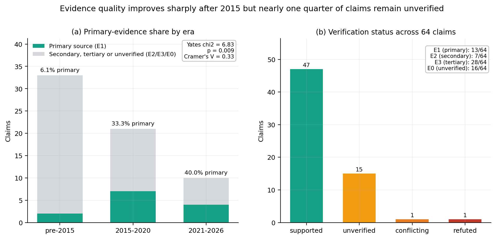
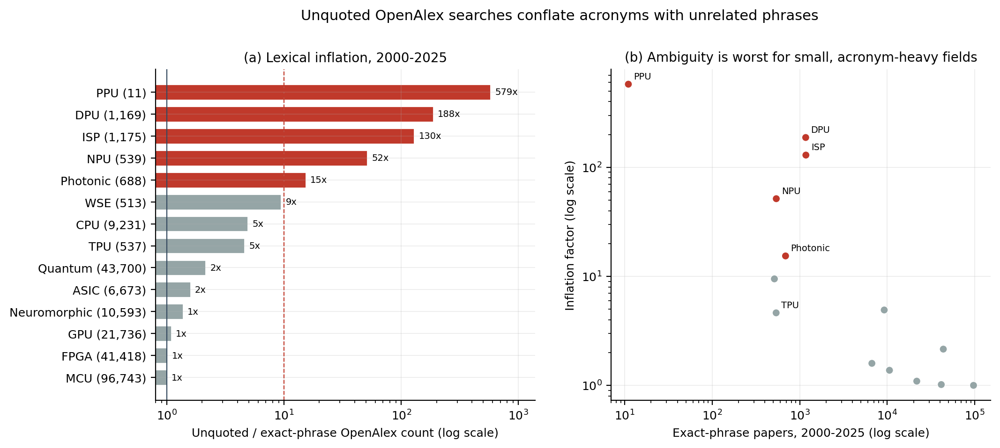
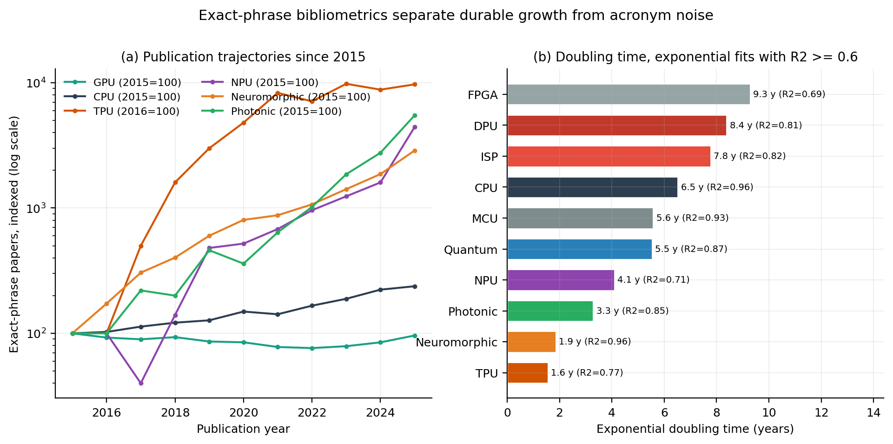
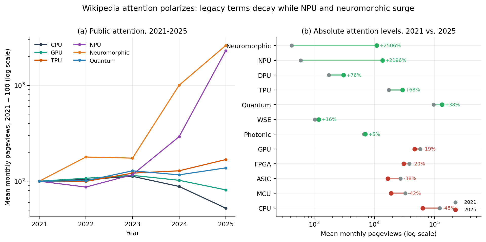
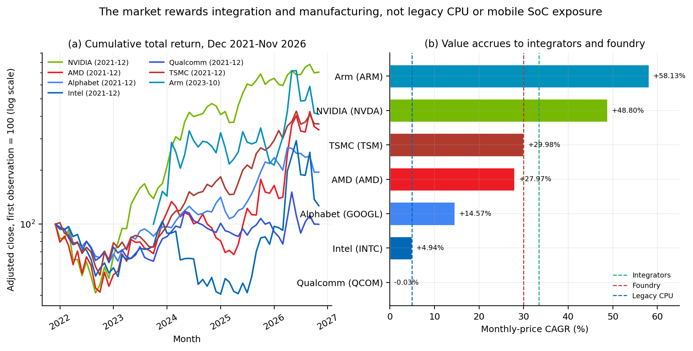
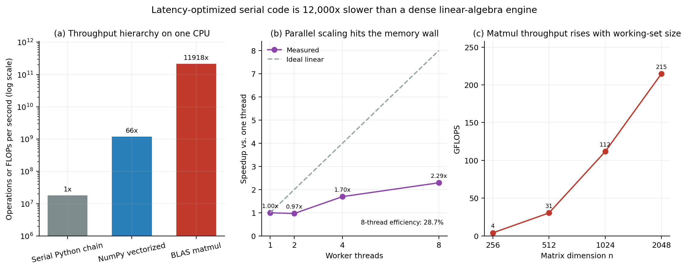

# XPU-Atlas

## A Reproducible Evidence Audit of Twenty Processing-Unit Paradigms, 1971-2026

**Working paper v0.1.0 - 4 November 2026**

**XPU-Atlas Project**

---

## Abstract

Popular technology narratives now describe a zoo of processing units: CPUs, GPUs, TPUs, NPUs, DPUs, LPUs, QPUs, photonic chips and even biological computers. This paper turns one such narrative into a testable corpus. We extract 64 factual claims about 20 processing-unit paradigms, grade each claim against 58 public sources, and freeze three independent live-data snapshots: OpenAlex publication counts (14 terms, 2000-2025), Wikimedia pageviews (12 articles, 70 months) and Yahoo Finance monthly prices (8 tickers). We then add a local latency-versus-throughput benchmark and release the entire pipeline as a deterministic, Docker-reproducible artifact.

Four results stand out. First, 73.4% of claims are supported (95% Wilson CI 61.5-82.7%), but only 20.3% rest on primary evidence; the primary-evidence share rises from 6.1% for pre-2015 claims to 40.0% for 2021-2026 claims (Yates chi-square = 6.83, p = 0.009, Cramer's V = 0.327). Second, naive bibliometrics are unsafe for acronym-heavy fields: unquoted OpenAlex searches inflate counts by 187.8x for DPU, 129.5x for ISP and 51.6x for NPU, with a median inflation of 4.8x across 14 terms. Third, the dominant lifecycle is absorption: 40% of the paradigms are either absorbed into other units or integrated into systems-on-chip. Fourth, research output, public attention and market value diverge: GPU publications grew 5.4% per year from 2021 to 2025 while GPU Wikipedia pageviews fell 18.8%; NPU and neuromorphic pageviews rose by 2,196% and 2,506% from tiny bases; and equal-weight returns were 33.4% for integrators and 30.0% for the foundry versus 4.9% for legacy CPU and -0.03% for mobile SoC exposure. A single-machine benchmark quantifies the underlying architectural trade-off: a serial Python chain sustains 18.0M operations/s, while NumPy vectorization reaches 65.6x that throughput and BLAS matmul reaches 11,918x, with only 28.7% parallel efficiency at eight threads. The atlas is descriptive, not causal, and retains negative, conflicting and unverified evidence rather than discarding it.

**Keywords:** processor taxonomy; evidence audit; bibliometrics; reproducibility; accelerator architecture; OpenAlex; Wikimedia; market data

---

## 1. Introduction

The 2020s produced an unusual genre of technical communication: the processor taxonomy video. In a single narrative, viewers are told that the CPU is the professor, the GPU is a stadium, the TPU is a calculator, the NPU is a sommelier, the DPU is a customs officer, and the QPU is a probability machine. The metaphors are memorable. They are also load-bearing claims about history, architecture, adoption and economics.

This paper asks what happens when such a narrative is treated as a research object rather than as entertainment. We do not attempt a comprehensive survey of processor architecture. We ask three narrower questions:

- **RQ1 (evidence):** How well are the narrative's factual claims supported, and does evidence quality vary systematically by era?
- **RQ2 (patterns):** Which patterns emerge when the taxonomy is joined to publication, attention and market data?
- **RQ3 (reproducibility):** Can the entire audit be rerun offline from frozen public data and a single command?

The answers are organized as a claim ledger, a set of statistical tables, six figures and a reproducible pipeline. The contributions are:

1. **A graded claim corpus.** Sixty-four claims across 20 paradigms, each with a status (supported, unverified, conflicting or refuted), a grade (E1 primary, E2 secondary, E3 tertiary, E0 unverified) and one or more source identifiers.
2. **A live-data audit.** Exact-phrase and unquoted OpenAlex counts, Wikimedia pageviews and Yahoo Finance prices captured on 4 November 2026 and frozen with SHA256 hashes.
3. **Five hidden patterns.** Lexical inflation, an evidence gradient, lifecycle absorption, attention polarization and market value accrual. A sixth pattern, the latency-throughput frontier, is measured locally.
4. **A reproducible artifact.** `make all` regenerates every number, table and figure from the committed snapshots; `docker compose up` runs the same pipeline in a container.

The paper is deliberately forensic. It treats the transcript as a set of hypotheses, not as a authority. Where the narrative is right, the ledger says so. Where it is imprecise, the ledger records the imprecision. Where sources disagree, the conflict stays visible.

---

## 2. Data and Methods

### 2.1 Claim extraction and grading

The transcript's claims were extracted into `data/claims.yaml`. Each claim has a stable identifier (for example `dpu-002`), a statement, a status, a grade, one or more source references and an optional note. The ledger is validated on every run: identifiers must be unique, every source reference must exist, URLs must be absolute, and lifecycle labels must come from a fixed vocabulary.

The grading rubric is intentionally simple:

| Grade | Meaning |
|---|---|
| **E1** | Primary source: official release, regulatory filing, peer-reviewed paper, standard or API dataset. |
| **E2** | Reputable secondary source: major news wire, trade press or expert analysis. |
| **E3** | Tertiary source: encyclopedia or general reference. |
| **E0** | Unverified, conflicting or refuted; retained for transparency. |

Status and grade are separate. A claim can be `supported` by an encyclopedia (E3), or `unverified` despite a plausible secondary mention (E0). This separation matters: the headline verification rate counts support, while the primary-evidence share counts only E1. The latter is the stricter measure.

### 2.2 Source capture

Fifty-eight sources were retrieved on 4 November 2026. The source hierarchy prefers primary documents: vendor announcements, regulatory filings, peer-reviewed papers, standards and API datasets. Where a primary source was unavailable, the ledger records a secondary or tertiary source and grades the claim accordingly. The full register, including URLs and retrieval dates, is in [EVIDENCE.md](EVIDENCE.md#sources).

Two conflict-register entries deserve emphasis because they illustrate the audit's purpose:

- **`spu-003` (conflicting).** Secondary reports differ on whether the US Air Force's PS3 cluster used 1,760 or 1,716 consoles. The fetched Cell extract does not resolve the count, so the claim remains E0.
- **`lpu-003` (refuted).** The transcript says Nvidia paid "about $20" for Groq's technology. The reported figure is about **$20 billion** - a unit/scale error of roughly three orders of magnitude. The claim is retained as a refuted entry rather than silently corrected.

Other notes in the ledger flag similar issues: the transcript's "iPhone 10" is the iPhone X; the CL1's roughly 200,000-neuron Doom demo is not the unit's 800,000-neuron capacity; Extropic's 10,000x claim comes from simulations rather than production silicon.

### 2.3 Live-data snapshots

Three snapshots are committed under `data/snapshots/`:

| Snapshot | Source | Coverage | Rows / series |
|---|---|---|---|
| `openalex_counts.json` | OpenAlex API | 2000-2025 | 14 terms, quoted and unquoted |
| `wikimedia_pageviews.json` | Wikimedia REST API | Jan 2021-Oct 2026 | 12 articles, 70 months |
| `yahoo_prices.json` | Yahoo Finance chart API | Dec 2021-Nov 2026 | 8 tickers, monthly adjusted close |

The OpenAlex query uses `title_and_abstract.search`. For each term we store both the exact-phrase count (quoted) and the unquoted count. The quoted series is the primary bibliometric measure; the unquoted series exists only to quantify lexical ambiguity. The Wikimedia series uses the official pageview API and the canonical article for each term. The Yahoo series uses monthly adjusted closes, which include dividends and splits.

Snapshot integrity is recorded in `data/snapshots/capture_manifest.json`:

| File | SHA256 |
|---|---|
| `openalex_counts.json` | `7512dfd09dfc97195cfdb8dbeae3e59a01c541e3c915d50ebbb52df52931ff95` |
| `wikimedia_pageviews.json` | `e45e5c6dca17c0adc983b15bb539a4eab2fe4fcc13b3df8cdc7e5ffa25bd051c` |
| `yahoo_prices.json` | `c641f5623c8382056826c77961ce304cb6922e96caef5b69ef05d56054121d12` |

`make fetch` refreshes the snapshots from the live APIs. `make all` uses the committed snapshots and does not require network access. This distinction is deliberate: live data change, but a paper needs a fixed version of record.

### 2.4 Statistics

- **Verification rate.** Supported claims divided by all claims, with a 95% Wilson score interval.
- **Evidence gradient.** A 2x2 table of era (pre-2015 vs 2015+) by primary evidence (E1 vs not E1), tested with a Yates-corrected chi-square and reported with Cramer's V.
- **Bibliometric growth.** Compound annual growth rate (CAGR) from 2021 to 2025 and an exponential fit to yearly counts. Doubling time is `ln(2) / slope` when the slope is positive; fits with R2 below 0.6 are marked poor and their doubling times are not interpreted.
- **Attention change.** Percentage change in mean monthly pageviews from 2021 to 2025. The 2026 months are excluded because the snapshot ends in October 2026.
- **Market performance.** CAGR from monthly adjusted closes, annualized volatility from monthly log returns, and maximum drawdown from the price path. Group returns are equal-weight baskets.
- **Coupling.** Pearson and Spearman correlations between publication CAGR and attention CAGR across the 12 terms with both series. This is exploratory: the terms are not independent samples.
- **Benchmarks.** Median wall-clock time over repeated trials, with IQR reported. The serial chain is a Python loop; the vectorized kernel is NumPy; matmul uses the platform BLAS. Thread scaling uses `ThreadPoolExecutor`. Optional RAPL energy is read from `/sys/class/powercap` when available.

No statistical test in this paper is pre-registered, and the claim-level tests are descriptive. The era test is the only inferential test with a stated p-value; it should be read as a signal, not as a causal estimate.

### 2.5 Local benchmarks

The benchmark suite answers a narrow question: how large is the latency-versus-throughput gap on one ordinary CPU? It does **not** measure a TPU, GPU, QPU or neuromorphic chip. It measures:

1. A serial Python chain (`x = (x * 3 + 1) % 2**31`) at 1M, 3M and 10M iterations.
2. The same affine kernel (`v*v + 3*v + 1`) in a Python list comprehension versus NumPy.
3. A thread pool applying the affine kernel to chunks of 1M elements at 1, 2, 4 and 8 workers.
4. Dense matrix multiplication at n = 256, 512, 1024 and 2048.
5. Optional package energy via RAPL, when the host exposes it.

The benchmark is intentionally modest. Its role is to make the paper's central architectural metaphor quantitative without pretending that a laptop is an accelerator.

### 2.6 Reproducibility

The pipeline has five stages:

```text
fetch -> claims -> analyze -> figures -> report -> paper-check

`make bench` is a separate, explicit refresh because benchmark numbers are hardware-dependent. The committed `results/bench.json` is the version of record used by the paper.
```

`make all` runs the offline stages in order. `make test` runs the pytest suite. `docker compose up --abort-on-container-exit` runs the same pipeline inside a pinned Python 3.12 image. The paper check verifies that the README contains the generated headline numbers and that no forbidden overclaims appear.

---

## 3. The Taxonomy

The transcript's 20 paradigms are summarized below. The year is the first public introduction or announcement recorded in the ledger, not the first conceptual work. Lifecycle labels are analytical constructs, not vendor categories.

| Unit | Name | Year | Lifecycle | Claims |
|---|---|---:|---|---:|
| CPU | Central Processing Unit | 1971 | general-purpose | 3 |
| GPU | Graphics Processing Unit | 1999 | general-purpose | 3 |
| PPU | Physics Processing Unit | 2006 | absorbed | 3 |
| APU | Accelerated Processing Unit | 2011 | integrated | 3 |
| SPU | Synergistic Processing Unit | 2006 | absorbed | 3 |
| NPU | Neural Processing Unit | 2017 | integrated | 4 |
| TPU | Tensor Processing Unit | 2015 | commercial | 3 |
| LPU | Language Processing Unit | 2016 | absorbed | 3 |
| MCU | Microcontroller Unit | 1971 | embedded | 3 |
| ISP | Image Signal Processor | 1990 | integrated | 3 |
| TPM / Secure Enclave | Security Processor | 2001 | integrated | 3 |
| ASIC | Application-Specific Integrated Circuit | 1980 | commercial | 3 |
| FPGA | Field-Programmable Gate Array | 1985 | commercial | 3 |
| DPU | Data Processing Unit | 2019 | integrated | 3 |
| WSE | Wafer-Scale Engine | 2019 | commercial | 4 |
| NPU (neuromorphic) | Neuromorphic Processor | 2014 | research | 3 |
| Photonic | Photonic Processor | 2025 | research | 3 |
| QPU | Quantum Processing Unit | 2019 | research | 4 |
| TSU | Thermodynamic Sampling Unit | 2026 | emerging | 3 |
| Wetware | Biological Processing Unit | 2022 | research | 4 |

The abbreviation collision is itself a finding. "NPU" denotes both a neural processing unit and, in the transcript's shorthand, a neuromorphic processor. "SPU" denotes the Cell Broadband Engine's synergistic processing unit, not a generic "signal processing unit." "PPU" historically denotes a physics processing unit, but the unquoted acronym retrieves a much larger and unrelated literature. These collisions motivate the lexical-inflation analysis in Section 5.1.

Lifecycle counts:

| Lifecycle | Count | Units |
|---|---:|---|
| general-purpose | 2 | CPU, GPU |
| embedded | 1 | MCU |
| commercial | 4 | TPU, ASIC, FPGA, WSE |
| integrated | 5 | APU, NPU, ISP, TPM/Secure Enclave, DPU |
| absorbed | 3 | PPU, SPU, LPU |
| research | 4 | Neuromorphic, Photonic, QPU, Wetware |
| emerging | 1 | TSU |

The most important number in this table is not the count of research paradigms. It is the **8 of 20 (40%)** units that were either absorbed into another unit or integrated into a system-on-chip. The taxonomy is therefore less a list of permanent categories than a record of architectural consolidation.

---

## 4. Evidence Audit

### 4.1 Overall results

| Metric | Value |
|---|---:|
| Claims | 64 |
| Paradigms | 20 |
| Sources | 58 |
| Supported | 47 (73.4%) |
| Unverified | 15 (23.4%) |
| Conflicting | 1 (1.6%) |
| Refuted | 1 (1.6%) |
| Primary evidence (E1) | 13 (20.3%) |
| 95% Wilson CI for support | 61.5-82.7% |

The grade distribution is E1 = 13, E2 = 7, E3 = 28, E0 = 16. The largest bucket is tertiary evidence. This is the central caveat of the audit: **support is not the same as primary support**. Wikipedia and general references are excellent for definitions and dates; they are weak for product specifications, financial figures and priority claims. The ledger therefore reports both numbers.

### 4.2 The evidence gradient

| Era | Claims | Primary (E1) | Primary share | Supported |
|---|---:|---:|---:|---:|
| pre-2015 | 33 | 2 | 6.1% | 22 |
| 2015-2020 | 21 | 7 | 33.3% | 17 |
| 2021-2026 | 10 | 4 | 40.0% | 8 |

The primary-evidence share rises monotonically with era. A Yates-corrected chi-square on the pre-2015 versus 2015+ split gives chi-square = 6.83, p = 0.009, Cramer's V = 0.327. The effect is moderate in magnitude and should not be over-interpreted: recent claims are easier to verify because press releases, filings and datasets are online, while older claims often require archival sources that this audit did not capture. The gradient is a statement about **source availability and verification practice**, not about the truthfulness of older engineers.



*Figure 5. Primary-evidence share by era and verification status across the 64 claims. The gradient is descriptive; the chi-square tests a 2x2 collapse of the era table.*

### 4.3 What the unverified claims look like

The 15 unverified claims are not random. They cluster into three types:

- **Product-stack generalizations.** "Consumer desktop CPUs in 2026 span roughly 4 to 24 cores" is plausible but was not sampled from vendor SKUs.
- **Historical priority claims.** Launch dates, first-use claims and "world's first" marketing statements often lack a primary source in the captured set.
- **Roadmap and capacity claims.** Future dates, unit capacities and performance projections are frequently announced but rarely documented in a stable primary source.

Keeping these claims visible is a design choice. A ledger that silently drops unverified statements creates a false sense of completeness. The atlas instead records them with E0 and a note explaining what would be needed to upgrade them.

---

## 5. Hidden Patterns

### 5.1 Lexical inflation: why acronym bibliometrics fail

The first hidden pattern is methodological. OpenAlex's unquoted search tokenizes the query and matches the tokens, not the phrase. For acronym-heavy fields, this conflates the target with homonyms, abbreviations and unrelated phrases. The effect is large:

| Term | Exact phrase | Unquoted | Inflation |
|---|---:|---:|---:|
| PPU | 11 | 6,369 | 579.0x |
| DPU | 1,169 | 219,566 | 187.8x |
| ISP | 1,175 | 152,202 | 129.5x |
| NPU | 539 | 27,795 | 51.6x |
| Photonic | 688 | 10,588 | 15.4x |
| WSE | 513 | 4,864 | 9.5x |
| CPU | 9,231 | 45,365 | 4.9x |
| TPU | 537 | 2,484 | 4.6x |
| Quantum | 43,700 | 93,935 | 2.1x |
| ASIC | 6,673 | 10,623 | 1.6x |
| Neuromorphic | 10,593 | 14,563 | 1.4x |
| GPU | 21,736 | 23,750 | 1.1x |
| FPGA | 41,418 | 42,103 | 1.0x |
| MCU | 96,743 | 96,743 | 1.0x |

The median inflation is 4.8x; five terms exceed 10x. The extreme value is **579x (PPU)**, but its denominator is only 11 exact-phrase papers; it should be read as an illustration, not as a stable estimate. The robust examples are DPU (188x on 1,169 papers), ISP (130x on 1,175) and NPU (52x on 539). Even a well-established term such as CPU inflates by 4.9x.



*Figure 1. Exact-phrase versus unquoted OpenAlex counts, 2000-2025. Panel (a) ranks terms by inflation; panel (b) shows that small, acronym-heavy fields inflate most. The PPU bar is illustrative because its denominator is only 11 papers.*

The practical lesson is simple: **quote the phrase, report the denominator, and show the unquoted count as a sensitivity check**. The atlas does all three. It also flags a residual limitation: quoting is not a complete fix. The WSE series contains a 2002 spike that is almost certainly unrelated to wafer-scale engines, and the quoted PPU series is too small for stable trend estimation. Exact-phrase search reduces ambiguity; it does not eliminate it.

### 5.2 Publication growth: domain-specific fields outpace general-purpose ones

Using exact-phrase counts, the median publication CAGR from 2021 to 2025 is 20.7%. The fastest-growing fields are photonic (71.2%), NPU (59.9%), quantum (43.1%) and neuromorphic (34.7%). The slowest are TPU (4.0%), FPGA (4.2%), ASIC (4.7%) and GPU (5.4%). CPU grows at 13.7%, MCU at 21.0% and DPU at 20.7%.

| Term | 2021-25 CAGR | Doubling time (years) | R2 | Fit |
|---|---:|---:|---:|---|
| Photonic | 71.2% | 3.29 | 0.85 | good |
| NPU | 59.9% | 4.10 | 0.71 | moderate |
| Quantum | 43.1% | 5.53 | 0.87 | good |
| Neuromorphic | 34.7% | 1.86 | 0.96 | good |
| WSE | 29.6% | n/a | 0.09 | poor |
| MCU | 21.0% | 5.58 | 0.93 | good |
| DPU | 20.7% | 8.39 | 0.81 | good |
| ISP | 18.7% | 7.77 | 0.82 | good |
| CPU | 13.7% | 6.52 | 0.96 | good |
| GPU | 5.4% | n/a | 0.59 | poor |
| ASIC | 4.7% | n/a | 0.55 | poor |
| FPGA | 4.2% | 9.28 | 0.69 | moderate |
| TPU | 4.0% | 1.56 | 0.77 | moderate |

Two cautions follow. First, a fast doubling time from a small base is not the same as a large field. TPU doubles every 1.6 years, but its exact-phrase corpus is only 537 papers; MCU doubles more slowly (5.6 years) from a corpus of 96,743. Second, GPU growth is **not** well described by an exponential (R2 = 0.59): the series is flatter than an exponential fit would suggest, which is consistent with a mature field whose research attention has shifted toward specialized accelerators.



*Figure 2. Exact-phrase publication trajectories since 2015 and exponential doubling times for fits with R2 >= 0.6. GPU and ASIC are omitted from panel (b) because their exponential fits are poor.*

### 5.3 Attention polarization: legacy terms decay while emerging labels surge

Public attention behaves very differently from publication output. Mean monthly Wikipedia pageviews fell 47.7% for CPU, 41.9% for MCU, 38.4% for ASIC, 19.7% for FPGA and 18.8% for GPU. They rose 2,505.8% for neuromorphic computing, 2,196.0% for NPU, 76.1% for DPU, 68.2% for TPU, 37.8% for quantum computing, 16.3% for WSE and 4.9% for photonic/optical computing.

| Term | 2021 mean | 2025 mean | Change |
|---|---:|---:|---:|
| Neuromorphic | 422 | 10,990 | +2,505.8% |
| NPU | 595 | 13,659 | +2,196.0% |
| DPU | 1,754 | 3,089 | +76.1% |
| TPU | 17,463 | 29,376 | +68.2% |
| Quantum | 97,170 | 133,858 | +37.8% |
| WSE | 1,024 | 1,191 | +16.3% |
| Photonic | 6,775 | 7,109 | +4.9% |
| GPU | 58,050 | 47,134 | -18.8% |
| FPGA | 38,445 | 30,872 | -19.7% |
| ASIC | 27,330 | 16,835 | -38.4% |
| MCU | 32,760 | 19,033 | -41.9% |
| CPU | 122,371 | 64,046 | -47.7% |

The median change is +10.6%, with 7 articles growing and 5 declining. The distribution is polarized, not uniformly bullish. This is consistent with a reallocation of curiosity from familiar labels to newer ones, but pageviews are a noisy proxy: an article can grow because of a product launch, a controversy or a single viral month.

The coupling between publication growth and attention growth is weak and exploratory: Pearson r = 0.46, Spearman rho = 0.38, n = 12. GPU is the clearest divergence: publications grew 5.4% per year while pageviews fell 18.8%. The atlas therefore treats attention and research output as separate signals, not as substitutes.



*Figure 3. Public attention to processor terms, 2021-2025. Panel (a) indexes each series to 2021; panel (b) shows absolute 2021 and 2025 levels on a log scale. The emerging terms start small and grow fast; the legacy terms start large and decline.*

### 5.4 Lifecycle absorption: specialization ends in integration

The taxonomy's lifecycle labels reveal a consistent pattern. Of 20 paradigms, 8 (40%) are absorbed or integrated:

- **Absorbed:** PPU (physics), SPU (Cell), LPU (language).
- **Integrated:** APU (CPU+GPU), NPU (neural), ISP (image), TPM/Secure Enclave (security), DPU (data).

The absorbed units did not disappear because their function became irrelevant. They disappeared as **standalone categories** because their function was folded into a host processor, a GPU or a SoC. The integrated units followed a similar path but retained a distinct block within a larger chip. The four research paradigms (neuromorphic, photonic, QPU, wetware) and the one emerging paradigm (TSU) are the candidates for the next absorption cycle. The commercial paradigms (TPU, ASIC, FPGA, WSE) persist because they retain a distinct programming model, a manufacturing advantage or a cloud business model.

This is the paper's most speculative pattern, and it is labeled as such. The lifecycle labels are analytical judgments recorded in the ledger, not measured variables. They are useful for generating hypotheses about integration and standardization; they are not a causal theory of processor survival.

### 5.5 Market value accrues to integrators and foundries

The market snapshot is descriptive, but the dispersion is large enough to be interesting. Over the 60 months ending in November 2026, monthly-price CAGRs were:

| Ticker | Company | Months | CAGR | Annualized vol | Max drawdown |
|---|---|---:|---:|---:|---:|
| ARM | Arm | 38 | +58.13% | 78.8% | -42.9% |
| NVDA | NVIDIA | 60 | +48.80% | 47.8% | -58.7% |
| TSM | TSMC | 60 | +29.98% | 36.4% | -49.0% |
| AMD | AMD | 60 | +27.97% | 62.4% | -58.3% |
| GOOGL | Alphabet | 60 | +14.57% | 32.0% | -39.1% |
| INTC | Intel | 60 | +4.94% | 68.4% | -60.8% |
| QCOM | Qualcomm | 60 | -0.03% | 40.9% | -41.0% |
| CBRS | Cerebras | 6 | n/a | 63.5% | -55.7% |

Equal-weight group returns tell the same story more compactly:

| Group | Equal-weight CAGR |
|---|---:|
| Integrators (NVDA, AMD, GOOGL) | +33.4% |
| Foundry (TSM) | +30.0% |
| Legacy CPU (INTC) | +4.9% |
| Mobile SoC (QCOM) | -0.03% |

Cerebras is a special case. It listed at $185 per share in May 2026; the first post-IPO monthly close in the snapshot is $221 in June 2026, and the November 2026 close is $97.82. That is a 55.7% decline from the June close and -47.1% from the IPO price. The six-month window is too short for an annualized CAGR, so the table reports n/a and the text reports total return.



*Figure 4. Cumulative total return and monthly-price CAGR, December 2021-November 2026. Arm's series begins in October 2023; Cerebras has only six monthly observations and is excluded from the CAGR bars. Group lines are equal-weight baskets.*

The pattern is consistent with value accruing to firms that integrate multiple processing units or manufacture leading-edge silicon, rather than to firms whose exposure is concentrated in legacy CPU or mobile SoC markets. It is **not** a causal claim: the window includes an AI capex cycle, a memory shortage, export controls and a concentrated bull market. A longer window, a broader universe and a factor model would be needed to separate architecture from these confounders.

### 5.6 The latency-throughput frontier

The final pattern is architectural, and it is measured rather than inferred. On a single Intel Core i7-14700F (28 logical cores, Python 3.12, NumPy 2.2.6), the benchmark gives:

| Metric | Value |
|---|---:|
| Serial Python chain | 18.0M ops/s |
| NumPy vectorized throughput | 1.18B ops/s |
| Vectorized / serial | 65.6x |
| Peak matmul | 214.8 GFLOPS |
| Matmul / serial | 11,918x |
| 8-thread speedup | 2.29x |
| 8-thread efficiency | 28.7% |
| 2-thread speedup | 0.97x |

The matmul results scale with working-set size: 4.1 GFLOPS at n = 256, 30.5 at 512, 111.7 at 1024 and 214.8 at 2048. The serial chain is latency-optimized: it does one dependent operation at a time and cannot use the machine's parallelism. The vectorized and matmul kernels are throughput-optimized: they expose many independent operations and let the hardware fill its pipelines. The 11,918x gap is the quantitative version of the transcript's "stadium versus professors" metaphor.

The thread-scaling result is equally important. At two threads the speedup is 0.97x, at four threads 1.70x and at eight threads 2.29x. The affine kernel is memory-bandwidth-bound, so adding threads quickly hits the memory wall. This is why "more cores" is not a universal answer: the workload must have enough arithmetic intensity and enough independent work to amortize synchronization and memory traffic.



*Figure 6. Local latency-throughput benchmarks. Panel (a) compares serial, vectorized and BLAS throughput on a log scale; panel (b) shows thread scaling against the ideal; panel (c) shows matmul throughput as the working set grows. These are CPU measurements, not accelerator measurements.*

The benchmark is deliberately small. It does not measure a TPU, GPU, QPU or neuromorphic chip, and it does not claim to. Its purpose is to anchor the paper's architectural language in a reproducible measurement that any reader can rerun on their own machine.

---

## 6. Discussion

### 6.1 For architecture

The absorption pattern suggests that the relevant design question is not "which unit wins?" but "where does the function live?" A specialized unit that cannot be integrated into a SoC must justify its existence through a distinct programming model, a manufacturing advantage or a cloud service. PPU and SPU could not; APU, NPU, ISP and DPU could. The next wave of research units will face the same test. The practical agenda is integration-ready design: memory hierarchy, coherence, toolchain, compilers and standard interfaces, not just peak TOPS.

### 6.2 For research practice

The lexical-inflation result is a warning for anyone using bibliometric data to compare processor fields. Unquoted acronym searches can overcount by two orders of magnitude. The fix is procedural: use exact phrases, report the denominator, show the unquoted count as a sensitivity check, and validate the series against known events. The WSE 2002 spike and the tiny PPU corpus show that even exact phrases are not a complete solution. Bibliometrics should be treated as one noisy signal among several, not as a direct measure of scientific importance.

### 6.3 For evidence and communication

The evidence gradient is the paper's most policy-relevant finding. Recent claims are far more likely to have primary support than older claims, which means that popular narratives about computing history are often built on tertiary sources. This is not a reason to ignore history; it is a reason to fund archival verification and to label claims by evidence grade. The atlas's conflict register - the PS3 node count and the Groq "$20" error - shows how quickly a memorable detail can become a false fact.

### 6.4 For markets and attention

The divergence between research output, public attention and market value is a caution against using any one of them as a proxy for the others. GPU publications grew while GPU pageviews fell; NPU and neuromorphic pageviews exploded from tiny bases; market returns concentrated in integrators and the foundry. Each signal measures something different: research activity, public curiosity and expected cash flows. A serious analysis should triangulate, not substitute.

---

## 7. Limitations

1. **One transcript, not a systematic review.** The 64 claims are a forensic sample of one narrative, not an exhaustive map of processor research. Different transcripts would yield different claims and different base rates.
2. **Source selection and verification bias.** The audit captured 58 sources, but paywalls, language barriers and archival gaps remain. A claim marked unverified may be true; the ledger records what was captured, not what exists.
3. **OpenAlex limitations.** Counts are title-and-abstract phrase matches, not full-text or field-weighted counts. Quoted search still conflates some phrases; the WSE 2002 spike and the PPU denominator are visible examples.
4. **Attention proxy.** Wikipedia pageviews measure public curiosity, not technical adoption. Bots, seasonality, article merges and viral events can dominate the signal.
5. **Market data.** Monthly adjusted closes are descriptive. The window includes an AI capex cycle and a concentrated bull market; the Cerebras series is only six months long. Nothing here is investment advice.
6. **Benchmark scope.** The measurements are single-machine CPU results. They do not measure accelerators, and the affine kernel is memory-bound. The 11,918x ratio is an illustration of the latency-throughput gap, not a universal speedup.
7. **Statistical independence.** The era chi-square treats claims as independent, but claims within a paradigm are correlated. The coupling correlation has n = 12 and is exploratory. No multiple-comparison correction is applied.
8. **Lifecycle labels.** The absorbed/integrated/commercial/research labels are analytical judgments, not measured variables. They are useful for hypothesis generation, not for causal identification.
9. **Temporal scope.** The snapshot date is 4 November 2026. Live data will differ. The committed snapshots are the version of record for this paper.

---

## 8. Reproducibility

### 8.1 Quick start

```bash
git clone <repository-url> xpu-atlas
cd xpu-atlas
make install
make all          # offline pipeline, then tests
make test
```

To refresh the live data:

```bash
make fetch        # requires network access
make all
```

To run in Docker:

```bash
docker compose build
docker compose up --abort-on-container-exit
```

### 8.2 Outputs

| Path | Contents |
|---|---|
| `results/evidence_audit.json` | Claim counts, grades, era test, conflict register |
| `results/analysis.json` | Full bibliometric, attention, market and benchmark analysis |
| `results/summary.json` | Headline numbers used by the paper |
| `results/bench.json` / `.csv` | Raw benchmark measurements |
| `figures/fig1..fig6` | Publication figures |
| `docs/EVIDENCE.md` | Full claim ledger and source register |
| `docs/RESULTS.md` | Generated tables for every analysis |

### 8.3 Tests

The test suite checks the ledger schema, the statistics (CAGR, drawdown, Wilson interval, chi-square), the snapshot integrity, the presence of generated outputs, and the paper's headline numbers. `make paper-check` is a lightweight guard against stale or unsupported numbers in the README.

### 8.4 What is frozen and what is live

The snapshots are frozen. The pipeline is deterministic given the snapshots. The live fetch is provided for replication and extension, but it is not required to reproduce the paper. This is the same distinction used in artifact evaluation: the version of record is the frozen data, and the live path is a convenience.

---

## 9. Conclusion

The processor zoo is real, but it is not a flat list of alternatives. It is a history of functions moving into and out of larger systems. The evidence audit shows that the popular narrative is mostly supportable at the level of definitions and rough history, but much weaker at the level of primary sources, product specifications and financial details. The bibliometric analysis shows that acronym-heavy fields are especially vulnerable to lexical inflation, and that exact phrases are a necessary but insufficient correction. The attention and market analyses show that research output, public curiosity and financial value are distinct signals that can move in opposite directions. The benchmark shows that the latency-throughput gap is enormous even on one ordinary CPU.

The atlas is offered as a template as much as a result. Its claim ledger, frozen snapshots, generated tables and Docker pipeline are designed to be forked, corrected and extended. The most useful next step is not another taxonomy video; it is a shared, graded, reproducible evidence base for the claims that such videos make.

---

## Data and Code Availability

- Claim ledger: [`data/claims.yaml`](../data/claims.yaml)
- Frozen snapshots: [`data/snapshots/`](../data/snapshots/)
- Analysis code: [`src/xpu_atlas/`](../src/xpu_atlas/)
- Generated evidence register: [`docs/EVIDENCE.md`](EVIDENCE.md)
- Generated results tables: [`docs/RESULTS.md`](RESULTS.md)
- Figures: [`figures/`](../figures/)
- License: code MIT; data CC-BY-4.0

## Key References

The full 58-source register, with grades and retrieval dates, is in [EVIDENCE.md](EVIDENCE.md#sources). The sources most directly used in this paper are:

- **S001** Wikipedia, *Central processing unit* (E3).
- **S002** Wikipedia, *Graphics processing unit* (E3).
- **S003** Wikipedia, *GeForce 256* (E3).
- **S011** Microsoft, *Introducing Copilot+ PCs* (E1).
- **S014** Google, *Our eighth generation TPUs: two chips for the agentic era* (E1).
- **S016** Groq, *Groq and Nvidia enter non-exclusive inference technology licensing agreement* (E1).
- **S018** CNBC, *Nvidia buying AI chip startup Groq for about $20 billion* (E2).
- **S028** Cerebras, *Cerebras Systems announces pricing of initial public offering* (E1).
- **S030** CNBC, *Cerebras scores OpenAI deal worth over $10 billion* (E2).
- **S034** Intel, *Intel builds world's largest neuromorphic system* (E1).
- **S037** *Nature*, photonic processor running AI models (E1, peer reviewed).
- **S040** Extropic, *From one to one billion: Torx, Thermalizers, and Z1* (E1).
- **S042** *Cell Press*, in vitro neurons learn and exhibit sentience (E1, peer reviewed).
- **S048** *BMJ*, PRISMA 2020 statement (E1, peer reviewed).
- **S050** MLCommons, *MLPerf Inference rules* (E1, standard).
- **S051** ACM, *Artifact review and badging* (E1, standard).
- **S052** NeurIPS, *Paper checklist* (E1, standard).
- **S053** OpenAlex, *Works API* (E1, dataset).
- **S054** Wikimedia Foundation, *Pageviews API* (E1, dataset).
- **S055** Yahoo Finance, *Chart API* (E1, dataset).

Where this paper makes a claim about a specific fact, the claim ID in `data/claims.yaml` is the pointer to the exact source or sources. The list above is a convenience index, not a replacement for the ledger.

## Citation

```bibtex
@misc{xpuatlas2026,
  title   = {XPU-Atlas: A Reproducible Evidence Audit of Twenty Processing-Unit Paradigms, 1971-2026},
  author  = {{XPU-Atlas Project}},
  year    = {2026},
  version = {0.1.0},
  note    = {Working paper; claim ledger, frozen snapshots and reproducible pipeline}
}
```

## Change Log

- **v0.1.0 (2026-11-04).** Initial claim ledger (64 claims, 20 paradigms, 58 sources), three frozen snapshots, evidence audit, bibliometric/attention/market analyses, local benchmarks, six figures and Docker pipeline.
